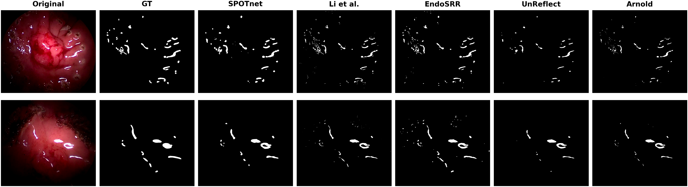
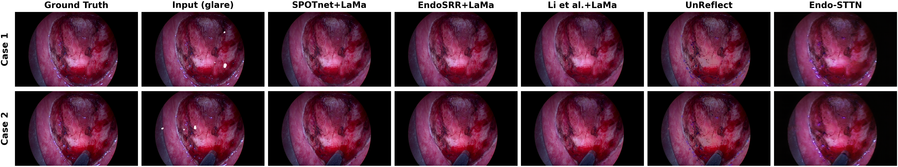
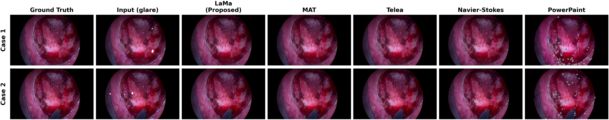
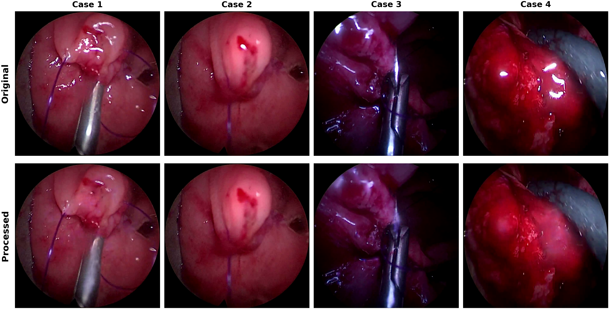

# SPOTnet: Weakly-Supervised Specular Reflection Detection and Removal for Minimal Access Surgery


https://github.com/user-attachments/assets/cdcb437a-ee68-43e8-965e-383ce04ed900


## Overview

**SPOTnet** is a weakly-supervised deep-learning pipeline for detecting and removing specular reflections (SR) in minimally invasive surgical (MIS) video. It requires **no manual annotations** — a large-scale specular exemplar library is built automatically from the physical signature of glare (high luminance, low saturation in HSV colour space), and used to train a lightweight U-Net detector. Detected regions are then restored with **LaMa** inpainting.

Beyond visual enhancement, SPOTnet is designed as a **scalable, annotation-free pre-processing stage that measurably improves downstream surgical computer vision** (e.g. semantic segmentation).

The full pipeline:
```
Endoscopic / MIS Frames
      │
      ▼
┌─────────────────────────────────┐
│  Step 1: Specular Library       │  HSV detection → morphological refinement → quality filtering → ~500K patch–mask pairs
└─────────────────────────────────┘
      │
      ▼
┌─────────────────────────────────┐
│  Step 2–5: SPOTnet Training     │  Lightweight U-Net + Multi-Scale + Boundary-Aware Loss → SPOTnet (0.77M params)
└─────────────────────────────────┘
      │
      ▼
┌─────────────────────────────────┐
│  Step 6: Detect + Inpaint       │  SPOTnet mask → LaMa → specular-free output
└─────────────────────────────────┘
```


---

## Key Highlights

- **Annotation-free.** A fully automated HSV-based pseudo-labelling pipeline builds a library of ~500,000 patch–mask pairs from unlabelled surgical video — no manual masks required.
- **Lightweight.** SPOTnet has only **0.77M parameters** — **122× smaller** than EndoSRR (93.79M) — yet achieves the best detection accuracy among evaluated methods.
- **Downstream gains.** Specular removal improves downstream semantic segmentation (**mean F1 +26.9%** on TEMSET-24K, *p*<0.01), including the recovery of otherwise-undetectable tissue classes, and improves polyp segmentation on EndoScene (F1: 0.938 → 0.956).
- **Clinically assessed.** A prospective evaluation by **13 surgeons (207 assessments)** across six surgical phases reported **88.9% clinical trust** and **89.9% preserved anatomical detail**.

---

## Specular Reflection Detection

| Method | Params | Time (ms) | Accuracy | IoU | Recall | E-measure |
|--------|--------|-----------|----------|-----|--------|-----------|
| Arnold et al. | N/A | ~15 | 0.993±0.005 | 0.392±0.112 | 0.402±0.112 | 0.732±0.112 |
| Li et al. | 0.05M | ~117† | 0.993±0.004 | 0.474±0.127 | 0.533±0.117 | 0.904±0.079 |
| UnReflectAnything | 498M | ~261 | 0.992±0.005 | 0.375±0.130 | 0.385±0.131 | 0.709±0.137 |
| EndoSRR | 93.79M | ~150 | 0.994±0.004 | 0.566±0.150 | 0.674±0.157 | 0.959±0.055 |
| **SPOTnet (Ours)** | **0.77M** | **~48** | **0.995±0.003** | **0.613±0.116** | **0.740±0.106** | **0.963±0.041** |

*Evaluated on the manually annotated TEMSET-24K test set. Best results in **bold**. SPOTnet achieves the highest detection performance among all evaluated methods while remaining the most compact learning-based detector — 122× smaller than EndoSRR — all without any manual annotations.*

†*Inference times measured at each method's native resolution on a single RTX 3090. SPOTnet, EndoSRR and UnReflectAnything times correspond to the detection stage; Li et al.'s network produces detection and removal in a single inseparable forward pass, so its time reflects both stages.*


<p><em>Qualitative comparison of specular reflection detection. From left to right: original frame, ground-truth mask, and detections from SPOTnet, Li et al., EndoSRR, UnReflectAnything, and Arnold et al. SPOTnet most closely matches the ground truth, capturing both large specular regions and fine scattered highlights, while the competing methods miss a greater proportion of reflections.</em></p>

---

## Ablation Study

| Configuration | Multi-Scale | Boundary Loss | IoU | Recall | E-measure |
|---------------|:-----------:|:-------------:|:---:|:------:|:---------:|
| Baseline (Dice + BCE) | ✗ | ✗ | 0.594 | 0.660 | 0.938 |
| + Multi-Scale | ✓ | ✗ | 0.575 | 0.615 | 0.908 |
| + Boundary Loss | ✗ | ✓ | 0.581 | 0.625 | 0.915 |
| **SPOTnet (full)** | **✓** | **✓** | **0.613** | **0.740** | **0.963** |

*Multi-scale training and boundary-aware loss are complementary: combined, they yield the full SPOTnet, improving recall by 12.1% over the baseline.*

---

## Pipeline Timing

Per-stage runtime, measured as the median over 20 full-resolution (1080×1920) frames on a single NVIDIA RTX 3090:

| Stage | Time (ms) | Share (%) |
|-------|-----------|-----------|
| Preprocessing | 0.4 | 0.1 |
| Specular detection (SPOTnet) | 47.9 | 13.9 |
| Post-processing | 9.0 | 2.6 |
| LaMa inpainting | 287.4 | 83.4 |
| **Total** | **344.7** | **100.0** |

The **detection stage runs at ~21 FPS**, suitable for real-time use. The **complete detect-and-restore pipeline runs at ~2.9 FPS**, with LaMa inpainting the principal bottleneck (better suited to offline processing; acceleration of the inpainting stage is the clear target for future work).

---

## End-to-End Restoration Comparison

Complete restoration pipelines evaluated on a synthetic specular benchmark (realistic highlights added to specular-free tissue, so a clean reference is known), at native resolution within the corrupted region. LPIPS is perceptual (lower is better).

| Method | PSNR (dB) ↑ | SSIM ↑ | LPIPS ↓ |
|--------|:-----------:|:------:|:-------:|
| Endo-STTN | 22.97 | 0.676 | 0.5453 |
| UnReflectAnything | 22.08 | 0.869 | 0.3114 |
| Li et al. + LaMa | 26.30 | 0.834 | 0.2182 |
| EndoSRR + LaMa | **26.38** | 0.902 | 0.1462 |
| **SPOTnet + LaMa (Ours)** | 26.12 | **0.908** | **0.1214** |

*The detect-then-inpaint pipelines share the LaMa backend, so their PSNR is governed by mask quality and is statistically equivalent. SPOTnet supplies the most accurate masks, achieving the best structural (SSIM) and perceptual (LPIPS) fidelity.*


<p><em>Qualitative end-to-end restoration comparison. The LaMa-based pipelines (SPOTnet, EndoSRR, Li et al.) produce clean, faithful restorations; Endo-STTN is visibly blurrier, and UnReflectAnything alters the whole frame.</em></p>

---

## Choice of Inpainting Backend

Five inpainting backends applied to the **same SPOTnet-detected mask**, isolating restoration quality from detection. Two protocols: a tight mask at native resolution and a dilated mask at a common 288×288. Time is per-frame inference at a common 512×512 input (Telea/NS on CPU; MAT, PowerPaint, LaMa on an RTX 3090).

| Method | PSNR ↑ (tight) | SSIM ↑ | LPIPS ↓ | PSNR ↑ (dilated) | SSIM ↑ | LPIPS ↓ | Time (ms) ↓ |
|--------|:-----:|:-----:|:-----:|:-----:|:-----:|:-----:|:-----:|
| MAT | 25.98 | 0.849 | 0.2410 | 28.79 | 0.862 | 0.1480 | 63.7 |
| PowerPaint | 18.26 | 0.417 | 0.4998 | 18.55 | 0.428 | 0.4124 | 2127.9 |
| Telea | 24.75 | **0.908** | 0.1486 | 28.69 | 0.884 | 0.1535 | 12.7 |
| Navier–Stokes | 24.58 | **0.908** | 0.1457 | 28.66 | 0.882 | 0.1522 | 13.7 |
| **LaMa** | **26.12** | **0.908** | **0.1214** | **29.57** | **0.892** | **0.1422** | 39.7 |

*LaMa provides the best balance of pixel-level fidelity, perceptual quality, and runtime, supporting its selection as the restoration backend.*


<p><em>Qualitative comparison of inpainting backends on the same SPOTnet-detected mask. LaMa and the classical methods (Telea, Navier–Stokes) remove specular regions cleanly; MAT shows lower fidelity from the natural-image domain gap; PowerPaint introduces spurious hallucinated textures, illustrating the unsuitability of unconstrained generative inpainting for surgical restoration.</em></p>

---

## Downstream Segmentation Validation

To evaluate the impact of specular removal on downstream semantic segmentation, we trained **DeepLabV3+** separately on the original expert-labelled **TEMSET-24K** images and on the corresponding **specular-free enhanced images** produced by our pipeline. Training on enhanced images led to consistent improvements across **11 semantic classes**, with **average validation F1 increasing from 0.713 to 0.905 (a 26.9% relative improvement, *p*<0.01)**.

| Class | Val Acc (Original) | Val Acc (Enhanced) | Val F1 (Original) | Val F1 (Enhanced) |
|------|:---:|:---:|:---:|:---:|
| **Anatomy** ||||
| RectalWall | 0.950 | 0.977 | 0.892 | 0.951 |
| Lesion | 0.988 | 0.996 | 0.867 | 0.953 |
| RectalWallDefect | 0.978 | 0.990 | 0.834 | 0.927 |
| **Instruments** ||||
| Rectoscope | 0.987 | 0.996 | 0.886 | 0.960 |
| Retractor | 0.993 | 0.997 | 0.875 | 0.956 |
| Diathermy | 0.994 | 0.998 | 0.832 | 0.957 |
| **Miscellaneous** ||||
| Landmark | 0.996 | 0.998 | 0.460 | 0.804 |
| Blood | 0.998 | 0.999 | 0.351 | 0.679 |
| Feces | 1.000 | 1.000 | 0.000 | 0.871 |
| PoorVisibility | 0.992 | 0.995 | 0.854 | 0.899 |
| OutOfBody | 1.000 | 1.000 | 0.996 | 0.996 |
| **Average** | **0.989** | **0.995** | **0.713** | **0.905** |

*Impact of specular removal on downstream semantic segmentation (DeepLabV3+ on TEMSET-24K). Note the **Feces** class: entirely undetectable in the original frames (F1 0.000), it becomes segmentable after specular removal (F1 0.871).*


<p><em>Qualitative results of the proposed specular detection and inpainting pipeline on diverse surgical datasets.</em></p>

### External Validation on EndoScene

External validation on the **EndoScene** polyp segmentation benchmark (binary setting). Specular removal improved the **polyp-class validation F1 from 0.938 to 0.956**.

| Class | Val Acc (Original) | Val Acc (Enhanced) | Val F1 (Original) | Val F1 (Enhanced) |
|------|:---:|:---:|:---:|:---:|
| Background | 0.993 | 0.994 | 0.993 | 0.994 |
| Polyp | 0.940 | 0.955 | 0.938 | 0.956 |
| **Average** | **0.966** | **0.975** | **0.966** | **0.975** |

---

## Clinical Validation

A prospective evaluation by **13 surgeons** (11 colorectal, 2 general surgery; mean experience 12.1 years) across **207 assessments** and six surgical phases. Each surgeon answered three binary questions per side-by-side (original vs. processed) video pair.

| Criterion | Yes (%) |
|-----------|:-------:|
| Q1: Reflections adequately removed | 82.6% |
| Q2: Anatomical details preserved | 89.9% |
| Q3: Trusted for clinical use | 88.9% |
| All three criteria satisfied | 74.9% |

**By surgical phase (Q1 / Q2 / Q3, %):**

| Phase | n | Q1 | Q2 | Q3 |
|-------|:-:|:--:|:--:|:--:|
| Blood Suction | 13 | 92.3 | 100.0 | 92.3 |
| Bleeding | 26 | 88.5 | 88.5 | 84.6 |
| Dissection | 24 | 87.5 | 95.8 | 91.7 |
| Landmarking | 36 | 94.4 | 100.0 | 100.0 |
| Setup | 60 | 81.7 | 88.3 | 88.3 |
| Suturing | 48 | 66.7 | 79.2 | 81.3 |

*Performance is strongest in stable phases (Landmarking, Blood Suction) and most challenged in dynamic, instrument-heavy sequences (Suturing), consistent with the known limitations of frame-independent inpainting.*


<p><em>Representative cases from the clinical validation set where specular removal is most challenging (top: original; bottom: processed). These illustrate the frame types underlying the 17.4% of assessments in which reflection removal was rated inadequate.</em></p>

---

## Repository Structure

| # | Notebook | Description |
|---|----------|-------------|
| 01 | `01_specular_library_creation.ipynb` | Build the specular exemplar library via HSV detection + quality filtering |
| 02 | `02_spotnet_baseline.ipynb` | Train baseline U-Net (BCE + Dice) |
| 03 | `03_spotnet_multiscale.ipynb` | Add multi-scale training |
| 04 | `04_spotnet_boundary.ipynb` | Add boundary-aware loss |
| 05 | `05_spotnet_final.ipynb` | Full SPOTnet (Multi-Scale + Boundary) |
| 06 | `06_iterative_inpainting.ipynb` | Detect + inpaint (SPOTnet + LaMa) |
| 07 | `07_benchmark.ipynb` | Evaluate all models against baselines |
| — | `Original_Images_SegmentationDepLabV3.ipynb` | Downstream DeepLabV3+ segmentation experiment |

---

## Installation

```bash
git clone https://github.com/MahmoodAIForge/SPOTnet.git
cd SPOTnet
pip install -r requirements.txt
```

**Requirements:** Python 3.9+, PyTorch 2.0+, CUDA 11.8+ (see `requirements.txt`).

---

## Pretrained Weights

The released SPOTnet detector is the full model (Baseline + Multi-Scale + Boundary-Aware Loss), a `DetUNet(base=32)` with **0.77M parameters** (~3 MB checkpoint).

```python
import torch
from spotnet import DetUNet, tiled_inference

net = DetUNet(base=32).eval()
ckpt = torch.load("weights/spotnet.pt", map_location="cpu")
net.load_state_dict(ckpt["net"])

# full-resolution inference via tiling
soft_mask = tiled_inference(net, image_rgb, tile=384, overlap=96)
pred_mask = (soft_mask > 0.13).astype("float32")
```

*Checkpoints are stored as a dict with a `"net"` key. The detector is trained on 128×128 patches and applied to full-resolution frames via tiled inference (tile 384, overlap 96, threshold 0.13).*

---

## Model Architecture

SPOTnet is a lightweight **U-Net** (`DetUNet`) with:
- 3-level encoder–decoder with skip connections
- SiLU activations + BatchNorm
- Base channel width 32 → **~0.77M parameters**
- Composite loss: weighted BCE + Dice + boundary-aware term
- Trained on 128×128 patches; runs on full-resolution images via **tiled inference**

---

## Inpainting

Specular removal uses **LaMa** (Large Mask inpainting):
```bash
pip install simple-lama-inpainting
```
Predicted masks are dilated (kernel k=25) before inpainting to fully cover specular haloes.

---

## Citation

If you use this work, please cite:
```bibtex
@article{alam2026spotnet,
  title   = {SPOTnet: Weakly-Supervised Specular Reflection Detection and Removal for Minimal Access Surgery},
  author  = {Alam, Mahmood and Bilal, Muhammad and Khan, Ufaq and Cohen, Emil and Bapu, Deepa and Hajiyavand, Amir M. and Khan, Kifayat and Akanbi, Lukman and Ajayi, Anuoluwapo and Kumar, Vikas and Xie, Yutong and Ali, Muhammad A. and Beggs, Andrew D. and Khan, Muhammad Haris and Ashraf, Shazad Q.},
  year    = {2026}
}
```

---

## Acknowledgements

- [LaMa](https://github.com/saic-mdal/lama) — Large Mask inpainting
- [EndoSRR](https://github.com/Tobyzai/EndoSRR) — dataset and evaluation protocols
- [Arnold et al.](https://doi.org/10.1007/s11548-010-0507-y) — classical HSV baseline

The TEMSET-24K dataset is available on [Zenodo](https://zenodo.org/records/14016844) under a CC-BY-NC 4.0 licence.
