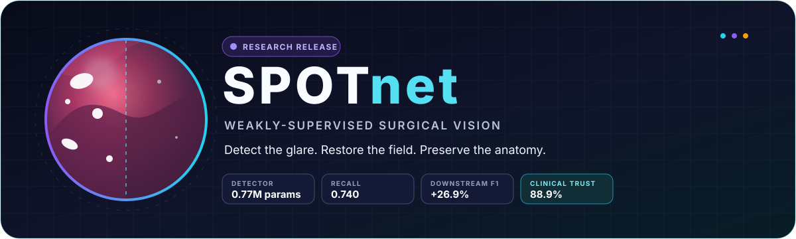
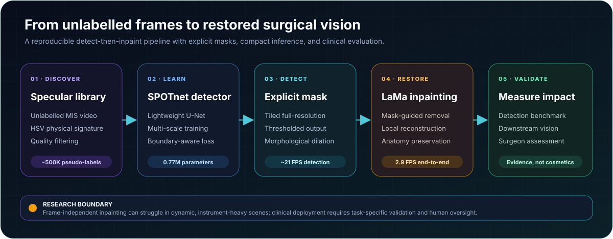

<p align="center">
  
</p>

<p align="center">
  <a href="#research-and-clinical-scope"></a>
  <a href="https://www.python.org/"></a>
  <a href="https://pytorch.org/"></a>
  <a href="weights/spotnet.pt"></a>
  <a href="LICENSE"></a>
</p>

<p align="center">
  <strong>Annotation-free specular detection and mask-guided restoration for minimally invasive surgical video.</strong>
</p>

<p align="center">
  <a href="#overview">Overview</a> ·
  <a href="#pipeline">Pipeline</a> ·
  <a href="#results-at-a-glance">Results</a> ·
  <a href="#quick-start">Quick start</a> ·
  <a href="#scientific-evidence">Evidence</a> ·
  <a href="#clinical-evaluation">Clinical evaluation</a> ·
  <a href="#citation">Citation</a>
</p>

> [!IMPORTANT]
> SPOTnet is research software, not a medical device. Inpainted pixels are model-generated estimates and must not be treated as diagnostic ground truth. See [Research and clinical scope](#research-and-clinical-scope).

## Overview

Specular reflections can obscure tissue boundaries, instruments, blood, and anatomical landmarks in minimally invasive surgery. SPOTnet treats glare removal as an **evidence-preserving, detect-then-restore problem**:

1. discover specular examples automatically from unlabelled surgical video;
2. learn a compact, explicit reflection detector without manual masks;
3. refine the predicted mask and restore only the affected region with LaMa; and
4. measure whether the result improves downstream vision while preserving clinically important detail.

The detector is a lightweight U-Net with **0.77M parameters**. Its weak supervision comes from approximately **500,000 automatically generated patch-mask pairs** built from the physical signature of glare—high luminance and low saturation in HSV colour space—followed by morphological refinement and quality filtering.

### Why SPOTnet

| Annotation-free learning | Compact detection | Explicit restoration | Evidence beyond appearance |
|---|---|---|---|
| Builds pseudo-labels from unlabelled MIS video. | Runs the detector at approximately 21 FPS on the reported RTX 3090 setup. | Produces a reviewable mask before any pixel is reconstructed. | Evaluates detection, restoration, downstream segmentation, and surgeon assessment. |

### Video demonstration

https://github.com/user-attachments/assets/cdcb437a-ee68-43e8-965e-383ce04ed900

## Results at a glance

| Detector size | IoU | Recall | E-measure | TEMSET-24K mean F1 | Clinical trust |
|:---:|:---:|:---:|:---:|:---:|:---:|
| **0.77M** | **0.613 ± 0.116** | **0.740 ± 0.106** | **0.963 ± 0.041** | **0.713 → 0.905** | **88.9%** |

<p align="center"><sub>Detection metrics use the manually annotated TEMSET-24K test set. Downstream F1 is the DeepLabV3+ average across 11 semantic classes. Clinical trust comes from 207 prospective assessments by 13 surgeons.</sub></p>

## Pipeline

<p align="center">
  
</p>

The pipeline separates **where a reflection exists** from **how that region is reconstructed**. This makes the mask inspectable, lets restoration backends be compared fairly, and avoids changing the entire surgical frame.

## Quick start

### Install

```bash
git clone https://github.com/MahmoodAIForge/SPOTnet.git
cd SPOTnet
pip install -r requirements.txt
```

**Environment:** Python 3.9+, PyTorch 2.0+, and CUDA 11.8+ for the reported GPU workflow. The detector can select CPU automatically, but inference will be slower.

### Run the pretrained detector

```python
import cv2

from spotnet import load_spotnet, predict_mask

image_bgr = cv2.imread("frame.png")
image_rgb = cv2.cvtColor(image_bgr, cv2.COLOR_BGR2RGB)

model = load_spotnet("weights/spotnet.pt")
mask = predict_mask(model, image_rgb)  # H × W, values in {0, 1}

cv2.imwrite("specular_mask.png", (mask * 255).astype("uint8"))
```

The included checkpoint is the full `DetUNet(base=32)` model trained with multi-scale augmentation and boundary-aware loss. It is applied to full-resolution images with tiled inference (`tile=384`, `overlap=96`, `threshold=0.13`).

### Add restoration

```bash
pip install simple-lama-inpainting
```

SPOTnet dilates the detected mask (`k=25` in the reported pipeline) before LaMa inpainting so the reconstruction covers reflection haloes as well as bright cores.

## Scientific evidence

### 1. Specular reflection detection

| Method | Params | Time (ms) | Accuracy | IoU | Recall | E-measure |
|---|---:|---:|---:|---:|---:|---:|
| Arnold et al. | N/A | ~15 | 0.993 ± 0.005 | 0.392 ± 0.112 | 0.402 ± 0.112 | 0.732 ± 0.112 |
| Li et al. | 0.05M | ~117† | 0.993 ± 0.004 | 0.474 ± 0.127 | 0.533 ± 0.117 | 0.904 ± 0.079 |
| UnReflectAnything | 498M | ~261 | 0.992 ± 0.005 | 0.375 ± 0.130 | 0.385 ± 0.131 | 0.709 ± 0.137 |
| EndoSRR | 93.79M | ~150 | 0.994 ± 0.004 | 0.566 ± 0.150 | 0.674 ± 0.157 | 0.959 ± 0.055 |
| **SPOTnet (ours)** | **0.77M** | **~48** | **0.995 ± 0.003** | **0.613 ± 0.116** | **0.740 ± 0.106** | **0.963 ± 0.041** |

SPOTnet produced the strongest detection metrics among the evaluated methods while remaining **122× smaller than EndoSRR**, without manual training masks.

† Inference times were measured at each method's native resolution on one RTX 3090. SPOTnet, EndoSRR, and UnReflectAnything timings cover detection; Li et al. performs detection and removal in one inseparable forward pass.


<p align="center"><sub>Original frame, ground-truth mask, and predictions from SPOTnet, Li et al., EndoSRR, UnReflectAnything, and Arnold et al.</sub></p>

### 2. Ablation study

| Configuration | Multi-scale | Boundary loss | IoU | Recall | E-measure |
|---|:---:|:---:|---:|---:|---:|
| Baseline (Dice + BCE) | ✗ | ✗ | 0.594 | 0.660 | 0.938 |
| + Multi-scale | ✓ | ✗ | 0.575 | 0.615 | 0.908 |
| + Boundary loss | ✗ | ✓ | 0.581 | 0.625 | 0.915 |
| **SPOTnet (full)** | **✓** | **✓** | **0.613** | **0.740** | **0.963** |

Multi-scale training and boundary-aware loss are complementary when combined, improving recall by 12.1% over the baseline.

### 3. Pipeline timing

Median per-stage runtime over 20 full-resolution 1080 × 1920 frames on one NVIDIA RTX 3090:

| Stage | Time (ms) | Share |
|---|---:|---:|
| Preprocessing | 0.4 | 0.1% |
| SPOTnet detection | 47.9 | 13.9% |
| Post-processing | 9.0 | 2.6% |
| LaMa inpainting | 287.4 | 83.4% |
| **Total** | **344.7** | **100.0%** |

The detector runs at approximately **21 FPS**. The full detect-and-restore pipeline runs at approximately **2.9 FPS**, with LaMa as the principal bottleneck and therefore best suited to offline processing in the reported implementation.

### 4. End-to-end restoration

Complete pipelines were evaluated on a synthetic specular benchmark with clean references. Measurements are taken at native resolution within the corrupted region; lower LPIPS is better.

| Method | PSNR (dB) ↑ | SSIM ↑ | LPIPS ↓ |
|---|---:|---:|---:|
| Endo-STTN | 22.97 | 0.676 | 0.5453 |
| UnReflectAnything | 22.08 | 0.869 | 0.3114 |
| Li et al. + LaMa | 26.30 | 0.834 | 0.2182 |
| EndoSRR + LaMa | **26.38** | 0.902 | 0.1462 |
| **SPOTnet + LaMa (ours)** | 26.12 | **0.908** | **0.1214** |


<p align="center"><sub>SPOTnet's mask quality supports the strongest structural and perceptual fidelity among the compared end-to-end pipelines.</sub></p>

### 5. Inpainting backend comparison

Five restoration backends were tested with the **same SPOTnet mask**, separating inpainting quality from detection quality. Timings use a common 512 × 512 input; Telea and Navier–Stokes run on CPU, while MAT, PowerPaint, and LaMa run on an RTX 3090.

| Method | PSNR ↑ tight | SSIM ↑ | LPIPS ↓ | PSNR ↑ dilated | SSIM ↑ | LPIPS ↓ | Time ↓ |
|---|---:|---:|---:|---:|---:|---:|---:|
| MAT | 25.98 | 0.849 | 0.2410 | 28.79 | 0.862 | 0.1480 | 63.7 ms |
| PowerPaint | 18.26 | 0.417 | 0.4998 | 18.55 | 0.428 | 0.4124 | 2127.9 ms |
| Telea | 24.75 | **0.908** | 0.1486 | 28.69 | 0.884 | 0.1535 | 12.7 ms |
| Navier–Stokes | 24.58 | **0.908** | 0.1457 | 28.66 | 0.882 | 0.1522 | 13.7 ms |
| **LaMa** | **26.12** | **0.908** | **0.1214** | **29.57** | **0.892** | **0.1422** | 39.7 ms |


<p align="center"><sub>PowerPaint's spurious textures illustrate why unconstrained generative restoration is risky in surgical imagery. LaMa provided the best reported balance of fidelity, perceptual quality, and runtime.</sub></p>

### 6. Downstream semantic segmentation

DeepLabV3+ was trained separately on original expert-labelled TEMSET-24K images and on the corresponding SPOTnet-enhanced images. Mean validation F1 across 11 classes rose from **0.713 to 0.905**, a **26.9% relative improvement** (*p* < 0.01).

| Class | Val Acc original | Val Acc enhanced | Val F1 original | Val F1 enhanced |
|---|---:|---:|---:|---:|
| **Anatomy** ||||
| RectalWall | 0.950 | 0.977 | 0.892 | 0.951 |
| Lesion | 0.988 | 0.996 | 0.867 | 0.953 |
| RectalWallDefect | 0.978 | 0.990 | 0.834 | 0.927 |
| **Instruments** ||||
| Rectoscope | 0.987 | 0.996 | 0.886 | 0.960 |
| Retractor | 0.993 | 0.997 | 0.875 | 0.956 |
| Diathermy | 0.994 | 0.998 | 0.832 | 0.957 |
| **Miscellaneous** ||||
| Landmark | 0.996 | 0.998 | 0.460 | 0.804 |
| Blood | 0.998 | 0.999 | 0.351 | 0.679 |
| Feces | 1.000 | 1.000 | 0.000 | 0.871 |
| PoorVisibility | 0.992 | 0.995 | 0.854 | 0.899 |
| OutOfBody | 1.000 | 1.000 | 0.996 | 0.996 |
| **Average** | **0.989** | **0.995** | **0.713** | **0.905** |

The **Feces** class was not detected in the original condition (F1 0.000) but reached F1 0.871 after enhancement in this experiment.


#### External validation on EndoScene

On the binary EndoScene polyp-segmentation benchmark, the polyp-class validation F1 improved from **0.938 to 0.956**.

| Class | Val Acc original | Val Acc enhanced | Val F1 original | Val F1 enhanced |
|---|---:|---:|---:|---:|
| Background | 0.993 | 0.994 | 0.993 | 0.994 |
| Polyp | 0.940 | 0.955 | 0.938 | 0.956 |
| **Average** | **0.966** | **0.975** | **0.966** | **0.975** |

## Clinical evaluation

A prospective evaluation included **13 surgeons**—11 colorectal and two general surgeons, with 12.1 years' mean experience—across **207 assessments** and six surgical phases.

| Criterion | Yes |
|---|---:|
| Reflections adequately removed | 82.6% |
| Anatomical details preserved | 89.9% |
| Trusted for clinical use | 88.9% |
| **All three criteria satisfied** | **74.9%** |

### Results by surgical phase

| Phase | n | Removal | Detail preserved | Trusted |
|---|---:|---:|---:|---:|
| Blood suction | 13 | 92.3% | 100.0% | 92.3% |
| Bleeding | 26 | 88.5% | 88.5% | 84.6% |
| Dissection | 24 | 87.5% | 95.8% | 91.7% |
| Landmarking | 36 | 94.4% | 100.0% | 100.0% |
| Setup | 60 | 81.7% | 88.3% | 88.3% |
| Suturing | 48 | 66.7% | 79.2% | 81.3% |

Performance was strongest in stable phases and weakest in dynamic, instrument-heavy suturing scenes, consistent with the known limitations of frame-independent inpainting.


<p align="center"><sub>Challenging clinical cases (original above, processed below) representing frame types in which reflection removal was rated inadequate.</sub></p>

## Model architecture

| Component | Implementation |
|---|---|
| Backbone | Three-level encoder-decoder U-Net with skip connections |
| Activations | SiLU with BatchNorm |
| Width | Base channel width 32 |
| Parameters | Approximately 0.77M |
| Loss | Weighted BCE + Dice + boundary-aware term |
| Training input | 128 × 128 patches |
| Full-resolution inference | Overlapping tiled inference |

The implementation lives in [`spotnet.py`](spotnet.py), with reusable helpers for checkpoint loading, image conversion, tiled inference, and binary-mask prediction.

## Reproduce the research path

| Stage | Notebook | Purpose |
|:---:|---|---|
| 01 | [`01_specular_library_creation.ipynb`](01_specular_library_creation.ipynb) | Build the HSV-derived specular exemplar library and apply quality filtering. |
| 02 | [`02_spotnet_baseline.ipynb`](02_spotnet_baseline.ipynb) | Train the baseline U-Net with BCE and Dice losses. |
| 03 | [`03_spotnet_multiscale.ipynb`](03_spotnet_multiscale.ipynb) | Add multi-scale training. |
| 04 | [`04_spotnet_boundary.ipynb`](04_spotnet_boundary.ipynb) | Add boundary-aware loss. |
| 05 | [`05_spotnet_final.ipynb`](05_spotnet_final.ipynb) | Train the full multi-scale, boundary-aware SPOTnet. |
| 06 | [`06_iterative_inpainting.ipynb`](06_iterative_inpainting.ipynb) | Detect, refine masks, and restore with LaMa. |
| 07 | [`07_benchmark.ipynb`](07_benchmark.ipynb) | Benchmark SPOTnet and comparator methods. |
| — | [`Original_Images_SegmentationDepLabV3.ipynb`](Original_Images_SegmentationDepLabV3.ipynb) | Run the downstream DeepLabV3+ experiment. |

### Repository map

```text
SPOTnet/
├── spotnet.py                         # Reusable detector and inference API
├── weights/spotnet.pt                # Released ~3 MB checkpoint
├── TEMSET_SpecularTest_Dataset/      # Example test images and masks
├── figures/                          # Detection, restoration, and clinical figures
├── 01_...ipynb → 07_...ipynb         # Ordered experimental workflow
├── requirements.txt
└── LICENSE
```

## Research and clinical scope

SPOTnet is intended for research into surgical-video enhancement and downstream computer vision.

- **Inpainting synthesizes content.** Restored pixels are plausible estimates, not direct observations and not evidence of pathology or anatomy.
- **Temporal consistency is not guaranteed.** The reported method processes frames independently; dynamic scenes can exhibit inconsistency or flicker.
- **Performance varies by phase.** Suturing and other instrument-heavy scenes were more challenging in the surgeon evaluation.
- **Clinical trust is not regulatory approval.** The prospective assessment supports further study but does not establish safety or effectiveness for autonomous clinical use.
- **Retain provenance.** Research workflows should preserve the original frame, predicted mask, restored frame, model version, and inference settings.

Any clinical or deployment use requires task-specific validation, governance, human oversight, and compliance with applicable medical-device and data-protection requirements.

## Data and acknowledgements

The TEMSET-24K dataset is available on [Zenodo](https://zenodo.org/records/14016844) under a CC BY-NC 4.0 licence.

SPOTnet builds on and compares with:

- [LaMa](https://github.com/saic-mdal/lama) — large-mask inpainting;
- [EndoSRR](https://github.com/Tobyzai/EndoSRR) — dataset and evaluation protocols; and
- [Arnold et al.](https://doi.org/10.1007/s11548-010-0507-y) — classical HSV-based reflection detection.

## Citation

If you use SPOTnet, please cite:

```bibtex
@article{alam2026spotnet,
  title   = {SPOTnet: Weakly-Supervised Specular Reflection Detection and Removal for Minimal Access Surgery},
  author  = {Alam, Mahmood and Bilal, Muhammad and Khan, Ufaq and Cohen, Emil and Bapu, Deepa and Hajiyavand, Amir M. and Khan, Kifayat and Akanbi, Lukman and Ajayi, Anuoluwapo and Kumar, Vikas and Xie, Yutong and Ali, Muhammad A. and Beggs, Andrew D. and Khan, Muhammad Haris and Ashraf, Shazad Q.},
  year    = {2026}
}
```

## License

Code is released under the [MIT License](LICENSE). Dataset and third-party assets retain their own licences.

<p align="center">
  <strong>SPOTnet</strong><br />
  Detect the glare · Restore the field · Preserve the anatomy
</p>
